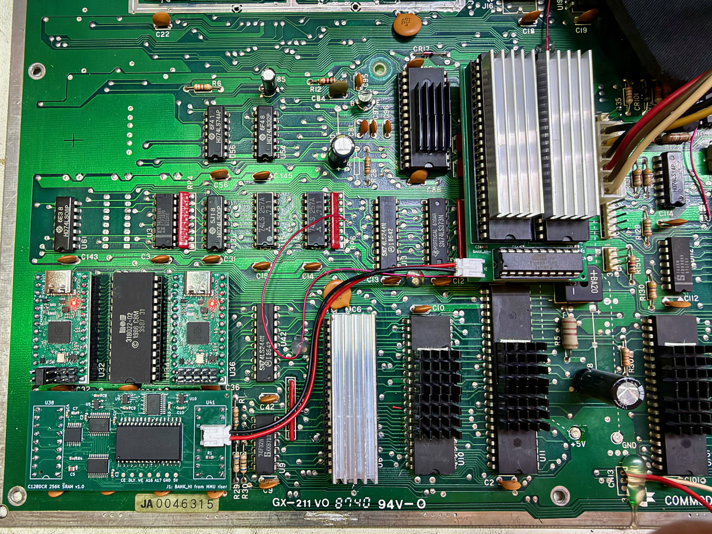
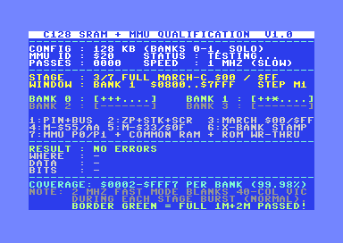

# Commodore 128 Memory Projects

Open-hardware memory upgrade and replacement boards for the Commodore 128 family (**C128**, **C128D**, and **C128DCR**), generated from Python.



---

## Project Status

* Commodore 128 flat - IN DEVELOPMENT
* Commodore 128D - BACKLOG
* Commodore 128DCR - AVAILABLE

--

## Design Philosophy: Zero Motherboard Modifications

Traditional 256 KB memory expansions for the Commodore 128 historically required invasive "motherboard surgery": desoldering or lifting factory resistor legs, tacking flying wires to logic ICs, and routing loose bodge wires across the board to the DRAM sockets.

The primary design principle of this project is **100% reversible, non-destructive upgrade**:
* **No trace cutting and no lifted components**: Motherboard resistors (such as R29/R30) remain intact in their factory configuration.
* **No soldered bodge wires**: The MMU riser and the SRAM module communicate via a single keyed 2-pin JST-PH cable (`BANK_HI` + `GND`).
* **Self-contained decoding**: All necessary bank switching and row/column address latching are handled on the expansion boards rather than offloaded onto motherboard gates.
* **Graceful fallback**: If the JST-PH cable is disconnected, the SRAM module automatically behaves as a standard 128 KB replacement with no jumper changes needed.
* **Full reversibility**: Removing the boards returns the machine to factory condition without any evidence of modification.

---

## Historical Context & Evolution

### The 1980s / 1990s Roots
The Commodore 128's custom Memory Management Unit (MOS 8722) contains internal register bits capable of managing up to four 64 KB RAM banks (256 KB total), but Commodore only wired support for two banks (Banks 0 and 1) to the DRAM bus.

In the late 1980s and 1990s, pioneering Commodore hardware hackers—notably **Marko Mäkelä** and **Pekka Pessi** (documented in [Memory expansions for the Commodore 128 on Zimmers.net](https://www.zimmers.net/anonftp/pub/cbm/documents/projects/memory/c128/1028/1028.html))—discovered that by placing a second MOS 8722 MMU in parallel and remapping its data bus during register writes, the second chip's internal bank pointer could be shifted. Its `/CAS1` output could then act as an enable signal for the upper banks (`/CAS2` and `/CAS3`). 

While electrically brilliant, these early implementations were complex and messy: they required lifting motherboard resistors R29 and R30, soldering taps onto U9 (74F08/74F32), running loose wires across the motherboard, and piggybacking extra DRAM ICs.

### ytmytm's Riser (c128-mmu-256k-exp)
Years later, **ytmytm** designed an elegant daughtercard ([`c128-mmu-256k-exp`](https://github.com/ytmytm/c128-mmu-256k-exp)) that modernized the dual-MMU concept using a GAL22V10. Crucially, ytmytm solved the mechanical problem of fitting two massive 48-pin DIP MMUs into the tight space beside the SID and power socket by using an **interleaved footprint layout** (plug P1, stock MMU U1, second MMU U2 spaced on 6.35 mm offsets).

However, that design still adhered to the 1990s installation method:
* Required lifting R29/R30 on the motherboard.
* Required running four loose wires across the motherboard to U9 and the RAM sockets.
* Carried forward subtle logical bugs from the original 1999 GAL equations.

### This Project
This project builds directly on the mechanical footprint work of ytmytm and the dual-MMU theory of Mäkelä and Pessi, but pairs the MMU riser with a dedicated **drop-in Static RAM module**:
* **Moves bank decoding onto the SRAM module**: Rather than decoding `/CAS0`–`/CAS3` on the riser and running multiple wires to the motherboard, the riser outputs a single `BANK_HI` signal.
* **Modern ATF16V8B GAL**: Replaces the larger GAL22V10 with a standard ATF16V8B (or discrete 74AHCT logic) with verified simulation and no read-cycle bus contention.
* **Modern low-power SRAM**: Replaces power-hungry, aging DRAM chips with a single fast static RAM (IS61C5128AS), reducing heat, power draw, and motherboard stress.

---

## Bugs Found & Fixed in Earlier Designs

During the re-engineering and simulation of earlier dual-MMU designs, several subtle bugs and electrical issues were uncovered and resolved:

### 1. The P0L / P1L Page Relocation Bug
* **The Bug**: The original 1999 Mäkelä/Pessi equations and ytmytm's GAL equations remapped data bit 6 to bit 7 at every address except `$D505` (the Mode Configuration Register, MCR). However, MMU registers `$D507` (P0L) and `$D509` (P1L) define the **low byte of page relocation** for Page 0 (zero page) and Page 1 (stack). Because bit 6 was unconditionally remapped during writes to `$D507`/`$D509`, whenever a program relocated the zero page or stack to a page where bit 6 $\ne$ bit 7 (for example, relocated to page `$40`), the second MMU stored `$00` instead of `$40`. Subsequent accesses to that relocated page caused the second MMU to miscalculate page matching, selecting the **wrong bank pair** and corrupting memory.
* **The Fix**: The new GAL logic ([`c128dcr/mmu-riser/gal/riser.pld`](c128dcr/mmu-riser/gal/riser.pld)) explicitly exempts `$D507` and `$D509` from bit 6 remapping. Both MMUs receive identical page pointer values.

### 2. Read-Cycle Data Bus Contention
* **The Bug**: In previous designs, the GAL outputs remapping the data lines into U2 were continuously driven active, even during CPU read cycles. When the CPU read from MMU registers, U2 attempted to drive the data bus at the same time the remap circuit was driving the inputs, causing direct bus contention, increased thermal stress, and voltage glitches.
* **The Fix**: The remap outputs on the ATF16V8B are tri-stated during read cycles (`/OE = !R/W`). The outputs are enabled only when `R/W` is low (CPU write cycles), allowing clean reads without contention.

### 3. Floating and Conflicted MMU Control Pins
* **The Bug**: Earlier riser designs either tied together or left ambiguously connected the second MMU's auxiliary system lines (`/Z80EN`, `/FSDIR`, `MS3`).
* **The Fix**: Guided by the Commodore 128 Programmer's Reference Guide (Table 16-9), the second MMU is treated strictly as a secondary RAM bank decoder. Its auxiliary outputs are left safely open, preventing signal collisions with the primary MMU.

### 4. Race Conditions in DRAM Replacement Timing
* **The Bug**: Standard DIY SRAM replacements often rely on "typical" gate delays (cascading several 74-series gates) to delay write pulses until address lines have settled. Because minimum gate propagation delays on modern high-speed CMOS (AHCT/ACT) can be less than 1 ns, a chain of gates provides no guaranteed worst-case setup time, risking memory corruption during write cycles.
* **The Fix**: The SRAM module implements a guaranteed passive RC delay (680 $\Omega$ / 33 pF) feeding a 74LVC1G17 Schmitt trigger buffer (`DLY`). This enforces a mathematically guaranteed $\ge 13$ ns address setup margin across all temperature, voltage, and component tolerance limits before `/WE` can fall.

---

## Machine Architecture & Folder Structure

```text
├── common/                  # Shared router (router_rs), footprints, DRC, KiCad generators
├── c128dcr/                 # Commodore 128DCR boards (complete, ready to build)
│   ├── sram/                # 4× 4464 DRAM replacement module (U38–U41)
│   └── mmu-riser/           # Dual-8722 MMU riser with ATF16V8B GAL
│       └── gal/             # GAL equations (riser.pld), riser.jed, check_gal.py
├── c128/                    # Commodore 128 (flat) & C128D boards (in active development)
│   ├── sram/                # 16× 4164 DRAM replacement (low-profile for keyboard clearance)
│   └── mmu-riser/           # Low-profile MMU riser for keyboard clearance
├── tools/
│   └── memtest/             # 32 KB U36 Function ROM March-C- & MMU qualification suite
├── AGENTS.md                # Agent guidelines and technical rules
├── LICENSE                  # MIT License
└── README.md
```

> **Note on build outputs:** KiCad project files (`kicad/`), render previews and BOM (`docs/`), and fabrication archives (`fab/`) inside each board directory are generated build outputs and are git-ignored.

### Motherboard & Board Status Matrix

| Model | DRAM Architecture | Space / Clearance Constraints | Board Directory & Implementation Status |
|---|---|---|---|
| **C128DCR** | 4× 64K×4 DRAM (4464, 18-pin DIP: U38–U41) | Metal desktop chassis, reasonable vertical clearance | [`c128dcr/sram/`](c128dcr/sram/) (**v1.0 hardware-verified** in 128 KB solo mode), [`c128dcr/mmu-riser/`](c128dcr/mmu-riser/) (**v1.0 design complete**, DRC & Gerbers ready, unbuilt) |
| **C128** (flat) | 16× 64K×1 DRAM (4164, 16-pin DIP: U42–U57) | Extremely tight vertical clearance under keyboard frame & RF shield | [`c128/sram/`](c128/sram/), [`c128/mmu-riser/`](c128/mmu-riser/) — **In Development** (specifications & clearance constraints defined) |
| **C128D** (plastic) | 16× 64K×1 DRAM (4164, 16-pin DIP: U42–U57) | Roomy desktop case; uses the same `c128` low-profile boards | [`c128/sram/`](c128/sram/), [`c128/mmu-riser/`](c128/mmu-riser/) — **In Development** (shares `c128` low-profile design) |

---

## C128 Memory Qualification ROM

The [`tools/memtest/`](tools/memtest/) directory contains a native MOS 8502
memory qualification and burn-in program for stock 128 KB machines, the SRAM
replacement in 128 KB solo mode, and the complete 256 KB SRAM/MMU-riser
upgrade. It starts from the C128's internal Function ROM before the Kernal
initializes RAM, automatically detects two or four 64 KB banks, and tests
65,521 of 65,536 bytes per bank (99.98%).

<p align="center">
  
</p>

<p align="center"><em>The ROM running in x128 VICE: 128 KB detected, Stage 3/7 at 1 MHz, with no errors.</em></p>

Each pass exercises the data and address buses, zero page, hardware stack,
screen RAM, the full remaining address space, cross-bank isolation, MMU page
relocation and Common RAM, and Function ROM write-through. The complete
seven-stage sequence runs once at 1 MHz with VIC-IIe DMA contention and again
at 2 MHz. A successful cycle turns the border green and continues as a
thermal burn-in test; a failure halts with the bank, address, speed, stage,
expected and actual values, XOR mask, and failing data bits on screen. Brief
screen blanking during the 2 MHz portions is normal.

### Build and Run

```bash
python3 tools/memtest/build.py
python3 tools/memtest/test_memtest.py
```

The build writes the raw 32 KB image to
`tools/memtest/fab/c128-memtest-u36.bin`; the second command runs the simulator
and fault-injection regression suite. Program that image into a OneROM or a
27C256-compatible 32 KB EPROM/EEPROM, install it in the C128's **U36 internal
Function ROM socket**, connect a display to the 40-column output, and power on
or reset the machine. The test starts automatically and loops until the
machine is powered off or reset.

The test is destructive to RAM: do not run it with data you expect to retain.
Its generated `fab/` directory is intentionally git-ignored.

For development, the same image can be run in VICE:

```bash
x128 -40col -intfunc 1 \
  -intfrom tools/memtest/fab/c128-memtest-u36.bin
```

### ROM and Cartridge Compatibility

| Delivery method | Current support | Details |
|---|---|---|
| U36 internal Function ROM | **Yes** | This is the image's intended target; both 16 KB halves remain available while the test destroys RAM beneath them. |
| x128 VICE internal Function ROM | **Yes** | Use `-intfunc 1` and `-intfrom` as shown above. |
| Native C128 external Function ROM cartridge | **Not as-is** | A cartridge variant is feasible, but it must select the external Function ROM in every MMU configuration and replace the U36-specific write-through test in Stage 7. |
| Ordinary C64-style 8 KB/16 KB cartridge | **No** | The test requires C128 mode, the MOS 8722 MMU, and resident lower and upper Function ROM code. |
| Disk, tape, or loadable PRG | **No** | A RAM-loaded program would overwrite its own code, zero page, and stack during the qualification pass. |

See the [memory tester documentation](tools/memtest/README.md) for the complete
stage descriptions, coverage exclusions, and border/status meanings.

---

## Build and Verify

The C128DCR boards are fully implemented and can be built immediately. Every board is generated from Python (`design.py` per board), routed with negotiated congestion routing, and checked both by its own design-rule check and by KiCad's ERC/DRC.

```bash
pip install -r requirements.txt

# C128DCR SRAM board (≈5 min full routing; --reuse to skip)
cd c128dcr/sram && python3 build.py

# C128DCR MMU riser (≈3 min full routing; --reuse to skip)
cd c128dcr/mmu-riser && python3 build.py

# Run the independent GAL 512-input logic simulation
python3 c128dcr/mmu-riser/gal/check_gal.py

# Run DRC regression tests
python3 common/test_drc.py

# Build and test the 32 KB U36 Function ROM memory qualification suite
python3 tools/memtest/build.py && python3 tools/memtest/test_memtest.py
```

*Requirements:* Python 3 with requirements installed. KiCad 9 (`pcbnew` Python module and `kicad-cli`) is required for zone fill, ERC/DRC verification, and Gerber generation.

---

## License

Released under the [MIT License](LICENSE).
